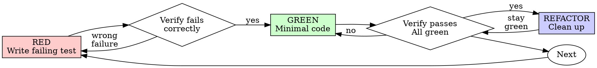

# Test-Driven Development (TDD) for DevOps

## Overview

Write the test first. Watch it fail. Write minimal code to pass.

**Core principle:** If you didn't watch the test fail, you don't know if it tests the right thing.

**This applies to all DevOps artifacts:** Terraform modules, Kubernetes manifests, CI pipeline configs, shell scripts, Ansible playbooks, and monitoring rules.

**When writing or changing tests, read [Writing Good DevOps Tests](writing-good-tests.md).** A test must be able to fail for the behavior it claims to protect; lint, schema validation, and runner dry-runs are useful layers, not proof of runtime behavior. For documentation-only changes, follow the project's content verification rather than inventing behavioral tests for prose.

**Violating the letter of the rules is violating the spirit of the rules.**

## When to Use

**Always:**
- Terraform/Pulumi/Ansible modules — write validation tests first
- Kubernetes manifests — write `kubeconform` or `kubectl --dry-run=server` validation first
- CI/CD pipeline changes — write the test job or step first
- Shell scripts and automation — write BATS or shunit2 tests first
- Monitoring/alerting rules — write the query and expected output first
- Any configuration change that affects production behavior

**Exceptions (ask your human partner):**
- Throwaway prototypes or one-shot environment teardowns
- Generated configuration (helm template output, kustomize build output — verify the generator instead)
- Exploratory debugging where you don't yet know the root cause

Thinking "skip TDD just this once"? Stop. That's rationalization.

## The Iron Law

```
NO PRODUCTION CONFIG WITHOUT A FAILING TEST FIRST
```

Write code before the test? Delete it. Start over.

**No exceptions:**
- Don't keep it as "reference"
- Don't "adapt" it while writing tests
- Don't look at it
- Delete means delete

Implement fresh from tests. Period.

## Red-Green-Refactor



### RED — Write Failing Test

Write one minimal test showing what should happen.

**For Terraform modules:**
```hcl
# tests/instance_test.tftest.hcl

run "create_instance_uses_correct_ami" {
  command = plan

  assert {
    condition     = aws_instance.app.ami == "ami-0c55b159cbfafe1f0"
    error_message = "Expected production AMI, got ${aws_instance.app.ami}"
  }
}
```

**For Kubernetes manifests:**
```bash
# Validate manifest against cluster API before applying
kubectl apply --dry-run=server -f manifests/deployment.yaml
```

This proves API/admission acceptance, not that selectors route traffic or the app becomes ready. Add a policy assertion or isolated integration check for the actual requirement. Confirm the cluster context before even a server dry-run.

**For shell scripts:**
```bash
# bats test
@test "healthcheck fails for unreachable endpoint" {
  run ./healthcheck.sh http://localhost:9999
  [ "$status" -eq 1 ]
  [[ "$output" == *"Connection refused"* ]]
}
```

**For CI pipelines:**
```yaml
# .github/workflows/test.yml
jobs:
  validate:
    runs-on: ubuntu-latest
    steps:
      - uses: actions/checkout@v4
      - name: Run validation
        run: make validate  # This test should fail first
```

**Requirements:**
- One behavior per test
- Clear name describing the expected outcome
- Assert required behavior or policy using parsed config/plan output or an isolated runtime; distinguish those claims from syntax/schema validation

### Verify RED — Watch It Fail

**MANDATORY. Never skip.**

```bash
# Terraform
terraform test

# Kubernetes manifest validation
kubectl apply --dry-run=server -f manifests/deployment.yaml; echo $?

# Shell scripts
bats tests/healthcheck.bats

# CI config validation
act --job validate --dryrun
```

`act --dryrun` checks runner planning only. Run the validation job itself in an appropriate isolated environment to establish its assertions. Use only project-approved tooling; do not add a test framework when an existing check or standard-library assertion covers the behavior.

Confirm:
- Test fails (not errors)
- Failure message is expected
- Fails because the feature/validation is missing (not because of setup issues)

**Test passes?** You're testing existing behavior. Fix the test.

**Test errors?** Fix the test setup, re-run until it fails correctly.

### GREEN — Minimal Code

Write simplest code to pass the test.

**For Terraform:**
```hcl
resource "aws_instance" "app" {
  ami           = var.production_ami
  instance_type = var.instance_type
  # Just enough to pass
}
```

**For Kubernetes:**
```yaml
apiVersion: v1
kind: Service
metadata:
  name: app-service
spec:
  selector:
    app: myapp   # Added to match the test's expectations
  ports:
    - port: 80
```

**For shell scripts:**
```bash
#!/bin/bash
# healthcheck.sh — minimal implementation
if ! curl -sf "$1" > /dev/null 2>&1; then
  echo "Connection refused"
  exit 1
fi
echo "OK"
```

Don't add features, refactor other code, or "improve" beyond the test.

### Verify GREEN — Watch It Pass

**MANDATORY.**

```bash
# Rerun the same test
terraform test
# or
bats tests/healthcheck.bats
```

Confirm:
- Test passes
- Other tests still pass
- Output pristine (no errors, warnings)

**Test fails?** Fix config/code, not the test.

**Other existing tests fail?** Investigate and report them, including pre-existing failures. Do not silently skip them or expand into unrelated fixes without agreement.

Before calling the task done or reporting it ready, run the project's full required verification, not just the new targeted check. Avoid live applies as test shortcuts; record checks requiring unavailable credentials/environment access as unverified.

### REFACTOR — Clean Up

After green only:
- Remove duplication (DRY up Terraform resources, extract common variables)
- Improve names (resource names, variable names, job names)
- Extract helpers (shared Terraform modules, common shell functions, composite GitHub Actions)

Keep tests green. Don't add behavior.

### Repeat

Next failing test for next feature or validation.

## DevOps-Specific Testing Tools

| Category | Tool | Example Test |
|----------|------|-------------|
| **IaC** | `terraform test` / `terraform plan` | Assert resource attributes, validate outputs |
| **IaC** | `terraform validate` / `tflint` | Syntax and style checks |
| **IaC** | `checkov` / `tfsec` | Security policy compliance |
| **Kubernetes** | `kubectl --dry-run=server` | Validate against live API schema |
| **Kubernetes** | `kubeconform` / `kubeval` | Offline manifest validation |
| **Kubernetes** | `conftest` with OPA/Rego | Policy-as-code for manifests |
| **Helm** | `helm lint` / `helm template \| kubeconform` | Chart structure and template output |
| **Shell** | BATS | Unit tests for shell scripts |
| **Shell** | shellcheck / shfmt | Static analysis |
| **Ansible** | `ansible-playbook --syntax-check` / `ansible-lint` | Playbook validation |
| **CI/CD** | `act` (local runner) / `nektos/act` | Run GitHub Actions locally |
| **CI/CD** | `yamllint` / `pre-commit` | Config file validation |
| **Monitoring** | `promtool check rules` | Validate Prometheus rules and alerts |

## Common Rationalizations

| Excuse | Reality |
|--------|---------|
| "Too simple to test" | One-line configs cause outages. Test takes 10 seconds. |
| "I'll test after" | Immediate passes may encode the implementation's assumptions; watching the intended failure demonstrates fault detection. |
| "terraform plan is my test" | Plan shows proposed change; assertions against requirements establish intent. |
| "Already manually validated" | Manual ≠ systematic. No re-runnable record. |
| "Deleting a configured module is wasteful" | Sunk cost fallacy. Keeping unverified config is tech debt. |
| "Keep as reference, write tests" | You'll adapt it. That's testing after. Delete means delete. |
| "Need to explore the API first" | Fine. Throw away exploration. Start with TDD. |
| "Test hard = module design unclear" | Listen to the test. Hard to test = hard to use. |
| "TDD will slow down IaC development" | TDD prevents incident response. Downstream time saved. |
| "kubectl apply already validates" | Only API schema. Not logic, policies, or intent. |
| "IaC is just config" | A wrong IAM policy, selector, or DNS value changes production behavior. Test that requirement. |
| "Existing infrastructure has no tests" | You're improving it. Write tests before changes. |

## DevOps-Specific Red Flags — STOP and Start Over

- Config before test
- Test after implementation
- "I'll just run terraform plan to check"
- "I already manually tested it"
- "kubectl apply --dry-run=client is good enough" (use `=server` for real validation)
- "Tests after achieve the same purpose"
- "This is just config, not code"
- "Keep as reference" or "adapt existing config"
- "Already spent X hours writing it, deleting is wasteful"
- "Testing against production is faster" (never test against production)
- "TDD is for software, not infrastructure"
- "I'll add the test in the next PR"

**All of these mean: Delete config. Start over with TDD.**

## Verification Checklist

Before marking work complete:

- [ ] Every new resource/module/manifest has a validation test
- [ ] Watched each test fail before implementing
- [ ] Each test failed for expected reason (validation missing, not setup error)
- [ ] Wrote minimal config to pass each test
- [ ] Full project-required verification ran; all failures, including pre-existing ones, are reported
- [ ] Change-related failures fixed; remaining errors, warnings, and unavailable checks explicitly accounted for rather than claimed green
- [ ] Tests assert behavior/policy; syntax/schema/dry-run evidence is identified separately
- [ ] Edge cases and failure modes covered
- [ ] Rollback validated (undo plan passes)

Missing a test cycle for changed behavior? Complete it before claiming TDD. Blocked on environment access or an existing failure? Report the blocker and obtain a disposition; do not rerun destructive actions or claim an unverified check passed.

## When Stuck

| Problem | Solution |
|---------|----------|
| Don't know how to test an IaC module | Write the `terraform { assert { ... } }` block first. Ask your human partner. |
| Terraform test too complex | Module design too complex. Simplify variables, split resources. |
| Kubernetes validation setup huge | Use `kubeconform` offline. Still complex? Simplify the manifest. |
| Must mock cloud provider | Mock only the boundary when needed; assert evaluated config/plan and do not claim real cloud behavior. |
| Shell script testing hard | Extract logic into small functions. Test each function with BATS. |

## Debugging Integration

Infrastructure bug found? Write a failing test reproducing it. Follow TDD cycle. Test proves fix and prevents regression.

**Never fix broken infrastructure without a test.**

## Final Rule

```
Production config → test exists and failed first
Otherwise → not TDD
```

No exceptions without your human partner's permission.
